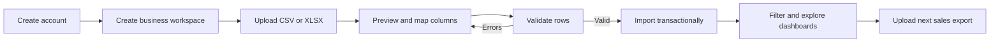
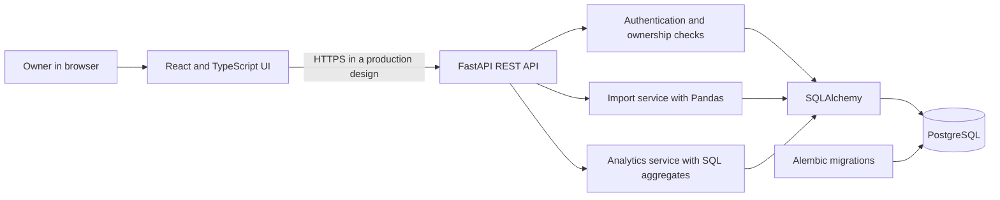
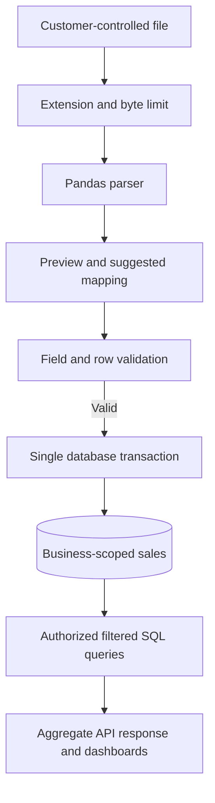
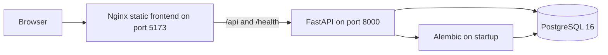
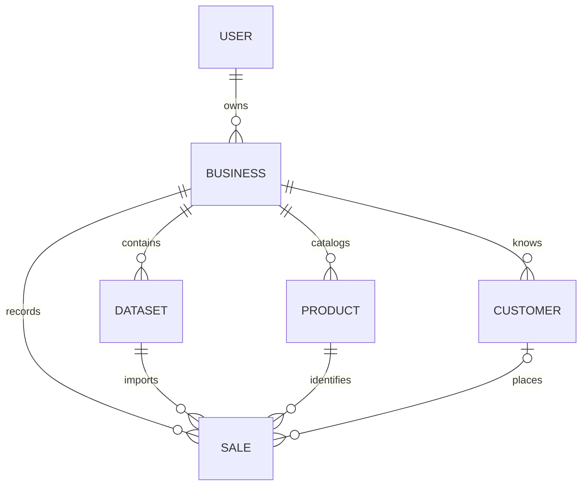
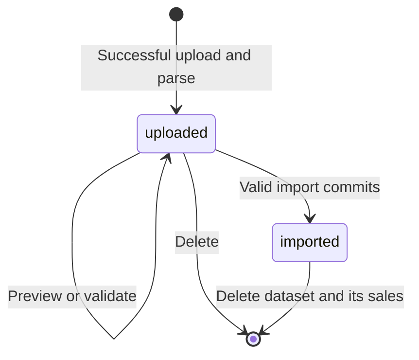
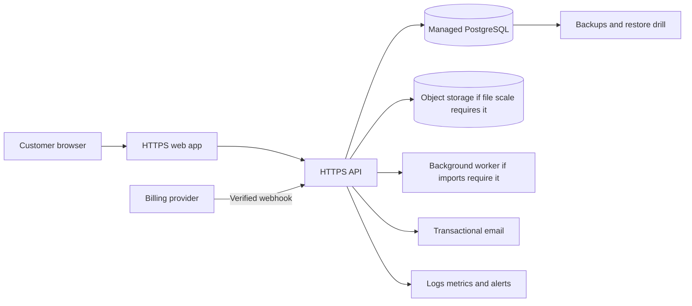
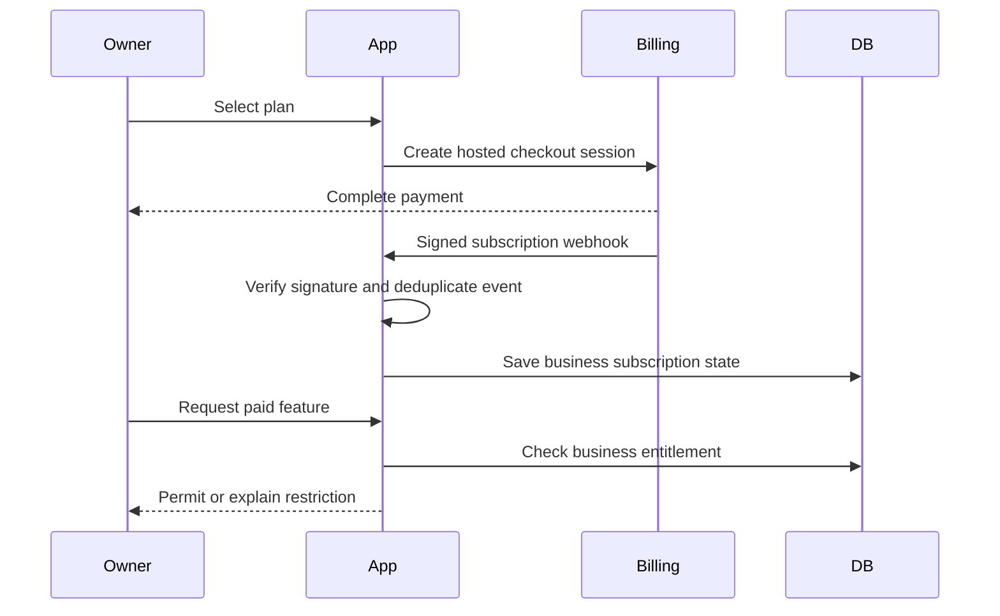

# InsightFlow System Blueprint

**Version:** 1.0  
**Prepared:** 3 October 2026  
**Audience:** Product owner, prospective customers, engineers, designers, security reviewers, and implementation partners  
**Status:** Current implementation plus a clearly marked hosted subscription plan

## Executive overview

InsightFlow turns sales exports into a business dashboard. An owner registers, creates a business workspace, uploads a CSV or Excel file, maps its columns, reviews validation errors, imports the rows, and explores sales, product, and customer analytics. A workspace belongs to one account and its data is isolated from other accounts by ownership checks in the API.

The repository implements a portfolio MVP, version 0.1.0. It can be demonstrated locally, but it has not been publicly deployed and does not include subscription billing or several controls needed before accepting paying customers' data. This document explains the implemented product, its technical design, operating model, limitations, and the staged work required to sell it as a hosted service.

| Area | Current implementation | Required for hosted sales |
| --- | --- | --- |
| Core product | Registration, workspaces, CSV/XLSX import, dashboards | Reconcile metrics against real customer exports |
| Accounts | Password login and eight-hour bearer JWT | Account recovery, email verification, stronger sessions, abuse controls |
| Data isolation | Owner checks on business and dataset routes | Full cross-customer security tests and operational review |
| Data processing | Synchronous import, 5 MB default, file bytes in PostgreSQL | Defined quotas, retention, recovery, and scaling decision |
| Billing | None | Pilot invoicing; later automated subscription lifecycle |
| Operations | Local Docker Compose; CI logic tests | Production hosting, monitoring, backup restore drill, incident process |
| Quality | SQLite API tests, frontend unit tests, manual browser review | PostgreSQL integration and end-to-end browser tests |

### Status language used in this document

**Implemented** means present in the code now. **Proposed** means a product or architecture decision for a future release. **Decision needed** means the owner must choose a market, policy, or commercial rule before implementation.

## 1 Product purpose and scope

### 1.1 Problem and value

Small businesses often have sales spreadsheets but no quick way to see trends, best-selling products, or customer spending. InsightFlow accepts a familiar file export and creates a consistent view of the underlying transactions. It is particularly suitable for retailers, online sellers, and distributors that can export line-item sales in the required format.

The current product answers questions such as: How much revenue did we make in the selected period? Which products and categories produced the most revenue? Who are our highest-spending named customers? How do daily revenue and order counts change? Where cost data is complete, what is gross profit and margin?

### 1.2 Intended users

| User | Main job | Current support |
| --- | --- | --- |
| Business owner | Upload sales and review overall performance | Implemented |
| Manager or analyst | Inspect products, customers, and trends | The owner can do this; separate team accounts are not implemented |
| SaaS operator | Support accounts, monitor health, manage subscriptions | Operational tools and billing are proposed |
| Customer administrator | Manage people and permissions within a business | Proposed; there is one owner per workspace today |

### 1.3 Current scope and boundaries

The MVP includes email/password registration, business creation and renaming, CSV/XLSX upload, preview, column mapping, validation, import, dataset listing and deletion, and four analytics views: Overview, Sales, Products, and Customers. Filters cover start and end date, product, category, and customer. Business settings allow workspace selection and name changes.

The MVP does not include payments, subscriptions, user invitations, role-based access, password reset, email verification, data export, inventory, tax handling, refunds, multiple currencies, scheduled reports, forecasting, or AI advice. Those capabilities must not be advertised as current features.

## 2 How a customer uses InsightFlow

### 2.1 End-to-end journey

1. **Register or sign in.** The API verifies credentials and issues an eight-hour access token. The browser stores that token and sends it as a bearer token on protected requests.
2. **Create a workspace.** A new account names its first business. An account may own multiple business workspaces; each has its own datasets and analytics.
3. **Upload a file.** The user uploads a `.csv` or `.xlsx` file, subject to the configured size limit. The service parses it and stores the original bytes with dataset metadata.
4. **Preview and map.** The user sees column names and eight sample rows. The application proposes a mapping for common header names; the user can change it.
5. **Validate.** The application reports row and field errors. A file with errors remains available for a corrected mapping, but its rows are not imported.
6. **Import.** All valid rows are written in one database transaction. The dataset changes from `uploaded` to `imported`. Reimporting the same dataset is rejected.
7. **Explore.** The dashboard reads aggregate results from the API. Changing a filter causes the API to recalculate the result for that business.
8. **Maintain data.** The user can list and delete datasets. Deleting an imported dataset removes its sale rows; unused product or customer dimension records may remain, but reports select through sales.

### 2.2 Screen map

| Screen | What the user sees | Principal actions |
| --- | --- | --- |
| Register and sign in | Account form and errors | Create account; authenticate |
| Workspace onboarding | Business name form | Create first workspace |
| Overview | KPIs, revenue trend, categories, top products and customers, recent sales | Apply common filters; add data |
| Sales | Revenue and order trends, recent sales | Inspect dates and orders |
| Products | Categories, top and lower-revenue products, full product table | Compare product performance |
| Customers | Spending, order counts, average spend by named customer | Identify higher-value customers |
| Datasets | Dataset list, upload, preview, mapping, validation messages | Import or delete a dataset |
| Business settings | Current name and workspace count | Rename or create a workspace |

### 2.3 Example input contract

Each row represents a **sale line**, not necessarily a whole order. An order can have several product lines with the same order ID. The current parser requires these canonical fields:

| Canonical field | Required | Meaning | Rule |
| --- | --- | --- | --- |
| `order_id` | Yes | Source transaction or order ID | Nonempty text |
| `date` | Yes | Sale date | Intended ISO date `YYYY-MM-DD`; the parser also accepts an ISO datetime and takes its date |
| `product` | Yes | Product or item name | Nonempty text |
| `quantity` | Yes | Units on the line | Finite number greater than zero |
| `unit_price` | Yes | Selling price per unit | Finite number at least zero |
| `category` | No | Product grouping | Defaults to `Uncategorized` if blank |
| `cost` | No | Unit cost | Finite number at least zero if supplied |
| `customer` | No | Customer name | Blank rows have no linked customer |

Example source headers that map automatically include `Transaction Number`, `Purchase Date`, `Item Name`, `Product Category`, `Qty`, `Selling Price`, `Unit Cost`, and `Buyer`. See `sample-data/small_sales.csv` for a working example.

## 3 System architecture

### 3.1 Implemented components

| Component | Technology | Responsibility |
| --- | --- | --- |
| Web client | React 19, TypeScript, Vite, React Router | Forms, navigation, mapping, charts, and states |
| Client data layer | TanStack Query | Fetching, caching, and invalidating server results |
| Charts | Recharts | Revenue, orders, and category visualizations |
| API | FastAPI, Pydantic | Route handling, input validation, authentication, and errors |
| Import service | Pandas, openpyxl | Parse, preview, validate, and normalize files |
| Analytics service | SQLAlchemy queries | Apply business and filter predicates; aggregate results |
| Database | PostgreSQL in intended runtime | Persist accounts, workspaces, files, dimensions, and sales |
| Schema changes | Alembic | Versioned database migrations |
| Local packaging | Docker Compose, Nginx | Run PostgreSQL, API, and static frontend locally |

The React application does not calculate authoritative business metrics from downloaded raw rows. It requests filtered aggregates from the API. TanStack Query refreshes affected views after dataset changes. The API enforces ownership before it reads or changes business and dataset resources.

### 3.2 Data flow and trust boundaries

The browser and uploaded files are untrusted inputs. The bearer token identifies a user, but the API separately checks that each requested business belongs to the user. The database is the source of truth for imported records. File parsing and synchronous import run within API requests today; they are bounded by the upload limit, but larger-scale processing is proposed as a background job.

### 3.3 Local deployment topology

Docker Compose provides a reproducible local stack. It is not a production deployment claim. Production needs a public HTTPS endpoint, managed secrets, backups, monitoring, controlled migrations, and a rollback process.

## 4 Data model and lifecycle

### 4.1 Entity relationships

| Table | Key fields | Relationship and purpose |
| --- | --- | --- |
| `users` | `id`, name, normalized unique email, password hash | One user owns zero or more businesses |
| `businesses` | `id`, `owner_id`, name | Security and reporting boundary |
| `datasets` | `id`, `business_id`, filename, type, bytes, status, row count | Keeps the exact uploaded source for preview and validation |
| `products` | `id`, `business_id`, name, category | Reused within a business by name and category |
| `customers` | `id`, `business_id`, name | Optional, reused within a business by name |
| `sales` | `id`, business, dataset, order ID, product, customer, date, quantity, price, cost | One imported sale line |

The schema uses integer keys, foreign keys, uniqueness rules for business-scoped product and customer names, and indexes for common ownership and analytics queries. Quantity is stored as a decimal with three fractional places; unit price and cost use two. `datasets.file_data` contains the uploaded bytes, so database retention and backup policies also cover source files.

### 4.2 Dataset states and failure behavior

An invalid upload is rejected before a dataset is stored. Validation can return up to 100 detailed issues plus a full issue count. A failed import rolls back its database transaction and leaves the dataset available. A successfully imported dataset cannot be imported a second time. There is no cross-dataset deduplication: uploading the same sales again as a new dataset can double-count them. That behavior is a priority product decision before real recurring imports.

## 5 Analytics definitions

All analytics queries start with the current `business_id`. Optional filters apply an inclusive start and end sale date and exact matches for product, category, or customer. A selected filter applies to every KPI, trend, table, and chart in the response. The four analytics routes return the same response structure; the frontend decides which parts to show on each screen.

| Metric | Implemented definition | Important interpretation |
| --- | --- | --- |
| Revenue | Sum of `quantity × unit_price` | Gross sales from imported lines; no refunds, discounts, or tax model |
| Units | Sum of `quantity` | Supports fractional quantities to three stored decimals |
| Orders | Count distinct `order_id` within the filtered business result | Reused IDs across datasets can merge in the count |
| Average order value | Revenue ÷ distinct order count | Zero if there are no orders |
| Gross profit | Revenue − sum of `quantity × unit_cost` | Shown only if every matching sale has a cost |
| Profit margin | Gross profit ÷ revenue × 100 | Unavailable when cost is missing or revenue is zero |
| Daily trend | Revenue and distinct orders grouped by sale date | Filters are applied before grouping |
| Product or category performance | Revenue and units grouped by product and category | Ranked by revenue |
| Customer performance | Spending, distinct orders, and spending per order | Includes only lines with a named customer |
| Recent sales | Ten newest matching sale lines | Ordered by date and row ID; not an order summary |

### 5.1 Worked calculation

Suppose one order contains two rows: 2 units at $20 with $12 unit cost, and 1 unit at $30 with $18 unit cost. Revenue is `2 × 20 + 1 × 30 = $70`. Cost is `2 × 12 + 1 × 18 = $42`. Gross profit is `$28`, margin is `40%`, units are `3`, distinct orders are `1`, and average order value is `$70`. If either row omits cost, the current API returns gross profit and margin as unavailable for that filtered result.

### 5.2 Accounting boundary

InsightFlow is an operational sales analytics tool in its current form. It does not reconcile bank deposits, calculate tax, account for refunds or discounts, or produce an audited financial statement. Those requirements need explicit source fields and business rules before they can be promised.

## 6 API contract

The REST base path is `/api`. JSON is used except for multipart file upload. Protected routes require `Authorization: Bearer <access_token>`. Standard errors use `{ "error": { "code": "...", "message": "...", "details": [] } }`. The running FastAPI server exposes OpenAPI at `/docs`.

| Method | Path | Purpose | Auth |
| --- | --- | --- | --- |
| POST | `/auth/register` | Create an account and return token | Public |
| POST | `/auth/login` | Authenticate and return token | Public |
| GET | `/auth/me` | Fetch the current user | Required |
| GET, POST | `/businesses` | List or create owned businesses | Required |
| GET, PATCH | `/businesses/{id}` | Read or rename an owned business | Required |
| GET | `/businesses/{id}/datasets` | List datasets | Required |
| POST | `/businesses/{id}/datasets/upload` | Upload a CSV or XLSX file | Required |
| GET | `/datasets/{id}` | Read dataset metadata | Required |
| GET | `/datasets/{id}/preview` | See columns, eight rows, and suggestions | Required |
| POST | `/datasets/{id}/validate` | Check a column mapping and its rows | Required |
| POST | `/datasets/{id}/import` | Import validated rows once | Required |
| DELETE | `/datasets/{id}` | Delete dataset and its sales | Required |
| GET | `/businesses/{id}/analytics/options` | List available filter values | Required |
| GET | `/businesses/{id}/analytics/{section}` | Return filtered metrics; four supported sections | Required |
| GET | `/health` | Liveness response | Public |

The analytics sections are `overview`, `sales`, `products`, and `customers`. The filter parameters are `start_date`, `end_date`, `product`, `category`, and `customer`. The server rejects a start date after the end date. Cross-account business or dataset IDs return 404 so the API does not reveal another owner's resource. The liveness route is `/health`, outside the `/api` base path.

## 7 Security and privacy

### 7.1 Implemented safeguards

Passwords are hashed with Argon2. Tokens expire after eight hours. Protected routes resolve the user and check business ownership. Uploads have allowed extensions, a configured byte limit, parsing before storage, and row validation. The application uses SQLAlchemy parameters, Pydantic request validation, restricted CORS origins, and stable error responses. Logs are intended to contain identifiers and counts rather than file contents or credentials.

### 7.2 Gaps before hosting paying customers

| Gap | Why it matters | Proposed action |
| --- | --- | --- |
| Token in browser `localStorage` | JavaScript in the origin can read it | Use a secure session design with HttpOnly cookies or a backend-for-frontend and CSRF controls |
| No password reset or email verification | Account recovery and identity assurance are incomplete | Add email delivery, one-time reset tokens, and verification |
| No rate limiting or abuse monitoring | Login and upload endpoints can be abused | Apply layered limits and alerting |
| No session revocation | A stolen token remains usable until expiry | Add revocable sessions and logout behavior |
| Extension-based upload type check | Malformed or deceptive files still require defensive handling | Add content checks, resource limits, and file security review |
| No audit trail | Support and incident review are harder | Record important account, import, deletion, and billing events |
| No user data export or complete account deletion workflow | Offboarding is incomplete | Define and implement export, retention, and deletion policy |
| No formal recovery verification | A database failure may lose customer files and sales | Back up and restore in a separate environment regularly |

Personal customer names may appear in uploads. The operator must choose data retention, hosting region, subprocessors, and support procedures based on the market where the service is sold. Jurisdiction-specific legal requirements should be reviewed with qualified local advisers. OWASP's Session Management Cheat Sheet, PostgreSQL backup documentation, and the W3C WCAG 2.2 recommendation are useful technical references; links appear in the references section.

## 8 Deployment and operations

### 8.1 What exists now

`compose.yaml` starts PostgreSQL 16, a FastAPI backend, and a static React frontend served by Nginx. The backend waits for the database health check, applies Alembic migrations, and starts Uvicorn. Nginx proxies `/api` and `/health`. The local application appears on port 5173; API documentation is on port 8000. The backend uses environment values such as `DATABASE_URL`, `JWT_SECRET`, `CORS_ORIGINS`, and `MAX_UPLOAD_MB`.

The repository has a project-level pnpm configuration for the development machine: its store is `D:/CodexData/pnpm-store`. This path is local tooling configuration, not part of the hosted customer architecture. Build artifacts and application files should remain on the intended project or deployment storage.

For a local run, copy `.env.example` to `.env`, replace the secrets, and run `docker compose up --build`. Open `http://localhost:5173`; register, create a workspace, and import the included sample file. The API explorer is at `http://localhost:8000/docs`.

| Setting | Purpose | Local default or requirement |
| --- | --- | --- |
| `POSTGRES_PASSWORD` | Password for Compose PostgreSQL | Must be set in `.env` |
| `JWT_SECRET` | Signs access tokens | Must be a long random secret |
| `DATABASE_URL` | API database connection | PostgreSQL URL for local or hosted database |
| `CORS_ORIGINS` | Permitted browser origins | `http://localhost:5173` for local use |
| `MAX_UPLOAD_MB` | Maximum uploaded file size | 5 MB by default |

### 8.2 Proposed production topology

The object store and worker are conditional: retain the current 5 MB synchronous path for a tightly bounded pilot if real files and load tests support it. Select a hosting region and payment provider after choosing the sales market. Keep staging and production separate, protect secrets, enforce HTTPS, use least-privilege database credentials, and deploy reviewed migrations before routing traffic. Define alert owners, incident response, customer communications, recovery time, and recovery point targets before a wider launch.

### 8.3 Operational runbook outline

1. **Deploy:** build immutable artifacts, run CI, deploy to staging, apply and verify migrations, then release to production.
2. **Monitor:** watch health checks, API error rate, import failures, database capacity, latency, and billing webhook failures.
3. **Recover:** restore a backup into a separate environment, verify account/dataset/sales counts and dashboards, then document recovery duration.
4. **Roll back:** return to a compatible application release; use the tested restore path if a migration irreversibly changes data.
5. **Support:** collect a workspace and dataset ID, inspect sanitized logs and import history, reproduce with a safe sample, and record the resolution.

## 9 Quality assurance and acceptance

| Area | Current evidence | Additional acceptance before a paid pilot |
| --- | --- | --- |
| Backend behavior | Pytest API cases using isolated SQLite | PostgreSQL migration and integration suite |
| Frontend behavior | Vitest/Testing Library tests and manual browser review | End-to-end signup, upload, map, import, filter, and delete flow |
| Security | Ownership logic and selected tests | Systematic two-account access tests and targeted review |
| Data accuracy | Formula and filter tests | Reconcile against real customer exports, including edge cases |
| Performance | Small sample files and bounded upload | Pilot-size import, concurrent use, and slow-query tests |
| Resilience | Transactional import | Backup restore drill and deployment rollback test |
| Accessibility | Semantic controls and focus styling | Keyboard and screen-reader review; WCAG 2.2 AA assessment |

### 9.1 Critical test scenarios

- Register two accounts and prove that neither can read, modify, import, delete, or filter the other's business and dataset IDs.
- Import a valid CSV and XLSX; try malformed files, missing required mappings, duplicate source columns, negative prices, zero quantity, missing costs, and repeated imports.
- Import overlapping files and verify the chosen duplicate policy. The current product has no cross-dataset deduplication.
- Compare every KPI and table with a known spreadsheet calculation under no filters and each filter combination.
- Delete an imported dataset and confirm its sales disappear from analytics without affecting other businesses.
- Test migration from a blank PostgreSQL database and from the previous schema version.
- Exercise customer-facing flows in a browser on desktop and mobile widths, including network and server errors.

## 10 Hosted subscription product design

This section is **proposed**. No billing or subscription entities or endpoints exist in version 0.1.0.

### 10.1 Recommended commercial model

Use one subscription per business workspace. Begin with a single plan that defines included users, monthly uploads, maximum file size, retained history, and support. Decide whether additional workspaces require additional subscriptions. A pilot can be sold through a written agreement and manual invoice while the product is closely supported. Automated self-service billing becomes necessary before opening broad public signups.

### 10.2 Billing flow to implement

The billing system should record provider customer and subscription IDs, plan, status, billing period, and processed webhook event IDs. The server must decide access from trusted subscription state. Handle creation, renewal, failed payment, grace period, cancellation, plan change, and reactivation. Offer customers a billing portal or equivalent way to update payment details and cancel according to the published terms. Choose a provider available in the intended selling country; Stripe is one possible provider, not a committed dependency.

### 10.3 Onboarding and support

A new customer should reach a verified first dashboard with one file. Provide a short file-format guide, example CSV, mapping guidance, explanations for missing profit, billing and usage visibility, a support route, and export/deletion instructions. Avoid promising integrations until they exist. Track activation, first successful import, repeated use, import failures, paid conversion, and cancellations without logging sensitive transaction rows.

### 10.4 Commercial and customer operations

**Decision needed:** choose the selling country and the first customer segment before setting prices or signing up for a payment provider. Prepare a business entity and merchant account as appropriate, secure the product domain, and review name and dependency licensing. Publish accurate plan limits, subscription and cancellation terms, a privacy notice, and a support contact. Have local legal and tax professionals review the terms, invoicing, data-processing obligations, and tax treatment for the chosen market. Define how a customer requests an export, deletion, billing correction, or incident update, then make the support team able to carry out those requests.

## 11 Decisions required before implementation

| Decision | Why it affects the product | Suggested first choice |
| --- | --- | --- |
| Initial customer segment | Determines file formats, language, onboarding, and sales message | One segment with accessible exports and 2–3 pilot prospects |
| Selling country and hosting region | Determines payment availability, privacy, tax, and data location | Choose before provider and legal work |
| Subscription unit | Determines data model and entitlement checks | Per business workspace |
| Currency | Current UI formats USD only | Start with USD only if it matches pilot customers |
| Duplicate policy | Recurring uploads can double-count sales | Define stable source order/line identity and reject or replace overlaps |
| Refund and discount treatment | Current revenue is gross line price times quantity | Declare out of scope or add explicit fields and rules |
| Data retention and deletion | Source bytes and sales live in the database | Publish periods and implement account export/deletion |
| Pilot limits | Controls performance and cost | Set tested file-size, row, and storage quotas |
| Team access | Current workspace has one owner | Defer until pilot demand establishes roles |

## 12 Roadmap from MVP to sales

| Stage | Work | Exit evidence |
| --- | --- | --- |
| 1 Customer discovery | Interview 5–10 prospects, obtain exports, define segment and promise | Real files, 2–3 pilot candidates, one-page offer |
| 2 Data trust | Resolve duplicate policy, reconcile calculations, improve import errors | Customer source totals match documented InsightFlow totals |
| 3 Paid-pilot safety | Strengthen sessions/accounts, verify tenant isolation, test PostgreSQL, restore backups | Security review and full critical flow pass |
| 4 Hosted pilot | Deploy HTTPS service, monitor, document terms and support, onboard limited customers | 2–5 customers using real data and a signed or invoiced pilot |
| 5 Subscription automation | Integrate supported payment provider and server-side entitlements | Lifecycle tests for pay, renew, fail, cancel, and restore access |
| 6 Public launch | Self-service onboarding, pricing page, operational runbook, broader QA | New customers can buy, use, manage, and leave without manual database edits |

The first paid pilot does not require AI, forecasting, inventory, complex pricing tiers, or automatic billing if manual invoicing and provisioning are clearly agreed. Public self-service signup does require a dependable billing and offboarding lifecycle.

### 12.1 Minimum paid-pilot gate

- A named pilot customer and a written offer, limits, support channel, and terms.
- Reconciled analytics on that customer's actual export and a documented duplicate policy.
- Secure account sessions, recovery, abuse controls, and cross-customer isolation tests.
- PostgreSQL integration tests, a browser end-to-end flow, and a reviewed security pass.
- HTTPS hosting, production secrets, monitoring, backup schedule, and a successful restore drill.
- A privacy, retention, export, and deletion process appropriate to the chosen market.
- A tested method to collect payment and identify which business is entitled to service.

### 12.2 Public launch gate

All paid-pilot criteria remain in force. Add self-service billing and cancellation, verified and idempotent webhooks, a billing portal, tested failure and renewal cases, repeatable deployment/rollback, documented incident response, and support capacity. Check that the landing page describes only implemented features and actual service limits.

## 13 Risks and mitigations

| Risk | Effect | Mitigation and priority |
| --- | --- | --- |
| Repeated sales exports double-count | Misleading revenue and orders | Define and test cross-dataset identity before pilot; critical |
| Customer data crosses business boundaries | Confidentiality failure | Ownership tests for every route and query; critical |
| Lost database loses both sales and original files | Customer data loss | Backups and restore drill; critical |
| Browser token theft | Unauthorized access until expiry | Replace `localStorage` token pattern; critical |
| Large or malicious workbook exhausts API resources | Slow or unavailable service | Strict limits, parsing controls, worker when needed; high |
| Billing event missed or duplicated | Incorrect paid access | Signed, idempotent webhooks and reconciliation; high for self-service |
| Mismatch between dashboard and source system | Loss of customer trust | Reconcile formulas and document excluded transactions; critical |
| Sales language exceeds product capability | Customer disputes | Accurate plan limits, documentation, and demos; high |

## 14 Glossary

| Term | Meaning in InsightFlow |
| --- | --- |
| Business or workspace | One owner's isolated set of datasets and analytics |
| Dataset | One uploaded source file with metadata and optional imported sales |
| Sale line | One row containing a product, quantity, price, date, and order ID |
| Mapping | Assignment from source-file headings to InsightFlow's canonical fields |
| KPI | Summary measure such as revenue or average order value |
| Entitlement | Server-side decision about what an active subscription permits; proposed |
| Paid pilot | Limited hosted use by named customers with explicit support and payment terms |

## 15 Source and reference map

This document is grounded in the version 0.1.0 repository as inspected on 3 October 2026. For implementation details, see `README.md`; `docs/product-requirements.md`; `docs/architecture.md`; `docs/database.md`; `docs/data-import.md`; `docs/api.md`; `docs/security.md`; `docs/deployment.md`; `docs/testing.md`; `backend/app/api.py`; `backend/app/models.py`; `backend/app/services/importer.py`; `backend/app/services/analytics.py`; `frontend/src/app/App.tsx`; and `compose.yaml`.

External technical references for proposed work: [OWASP session guidance](https://cheatsheetseries.owasp.org/cheatsheets/Session_Management_Cheat_Sheet.html), [PostgreSQL recovery guidance](https://www.postgresql.org/docs/current/continuous-archiving.html), [WCAG 2.2](https://www.w3.org/TR/WCAG22/), and [Stripe subscription webhooks](https://docs.stripe.com/billing/subscriptions/webhooks).
