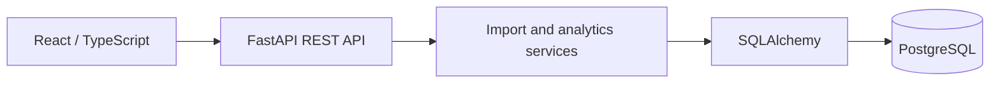
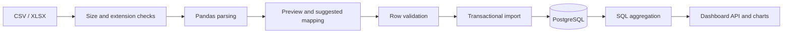

# Architecture

The React UI manages navigation, forms, states, and charts. TanStack Query caches server results and invalidates them after imports/deletions. FastAPI handles request validation and auth. Import and analytics logic live in `backend/app/services`; SQLAlchemy models represent the normalized database. Alembic handles schema changes.

Uploaded bytes are stored in `datasets.file_data` so preview and validation reuse the same exact source. `import_rows` creates/reuses business-scoped products and customers, writes sales, and commits once. If it fails, the request rolls back. Analytics use SQL aggregations and grouped queries; the frontend never downloads all sales rows. Every analytics section uses the same filter predicates.

The backend routes are kept in `api.py` for the compact MVP; data parsing and analytics are separate service modules. A larger codebase could split the router further by domain. The frontend separates auth, datasets, analytics, shared UI, and API transport.
