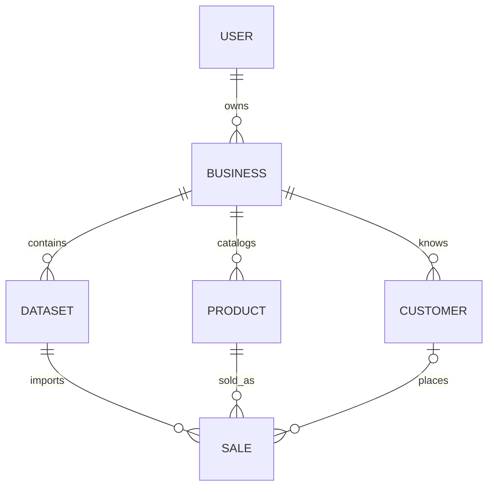

# Database

`users` stores a normalized unique email and Argon2 hash. `businesses` belongs to one user. `datasets` stores file metadata, bytes, status, count, and upload time. `products` and `customers` are business-scoped dimensions with unique name/category and name constraints respectively. `sales` references a dataset, product, optional customer, and business, and stores order ID, date, quantity, price, and optional unit cost.

All entities have integer primary keys. Foreign keys enforce relationships. Business/user/dataset links use cascading deletes; sale-to-product and sale-to-customer references are restrictive. Deleting a dataset removes its sales. Product/customer dimension rows can remain without sales, but reporting selects through sales. Most tables have creation timestamps; users and businesses also have update timestamps.

Indexes cover user email, business ownership, dataset business, dimension business, dataset sales, and composite business/date, business/product, business/customer sales access. `Numeric(14, 3)` stores quantity; `Numeric(14, 2)` stores price and cost. Alembic's `001_initial` migration creates all tables and indexes; production startup runs migrations, never `create_all`. Tests use `create_all` only for disposable SQLite databases.
